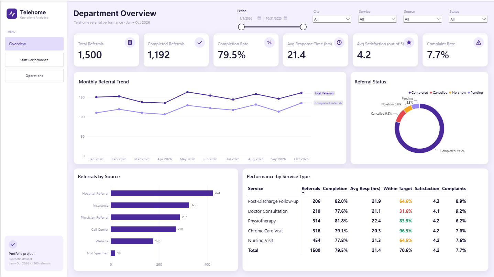
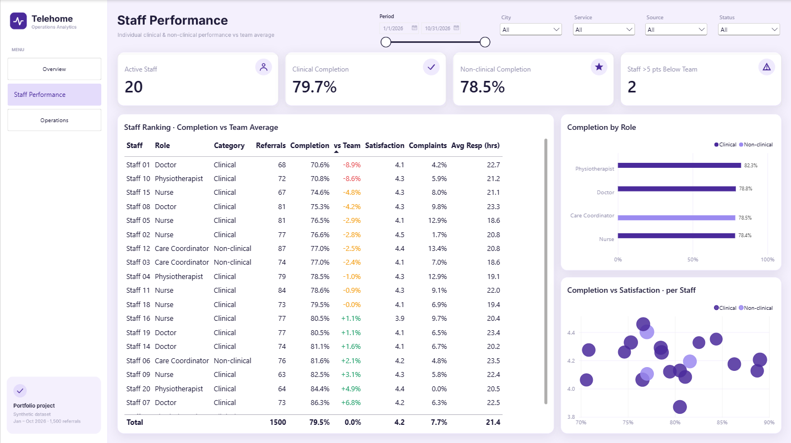
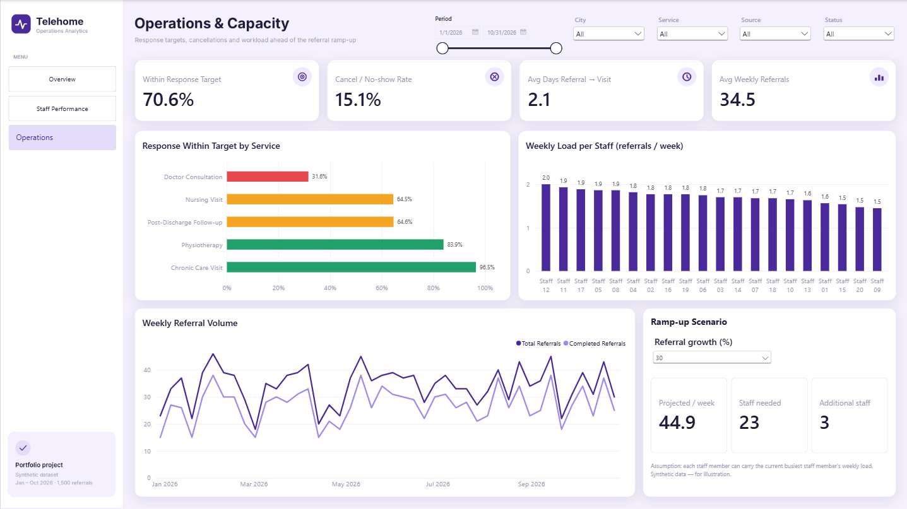

# Telehome Operations & Performance Analytics

An interactive **Power BI** dashboard that tracks departmental and individual staff performance for a home-healthcare (Telehome) service — referrals, response times against service targets, staff performance (clinical and non-clinical), service quality, and capacity planning for an expected rise in referrals.

> **Portfolio project, synthetic data.** All patients, staff and figures are fabricated for practice purposes. The project is modelled on the kind of work a Telehome performance analyst does; it is not affiliated with any real organisation.



---

## Business questions

1. How many referrals are we receiving, from where, and how many do we complete?
2. Are we responding to referrals **within each service's target time**?
3. How is each staff member performing against the team average, and does it differ between **clinical and non-clinical** roles?
4. How much of our demand is lost to cancellations and no-shows?
5. If referrals increase, **how many staff will we need**?

## Dashboard pages

| Page | What it answers |
|---|---|
| **Department Overview** | Six KPIs, monthly referral trend, referral status mix, referral sources, and a service-type performance matrix with conditional formatting against response targets. |
| **Staff Performance** | Staff ranking with completion **vs. team average**, clinical vs. non-clinical comparison by role, and a completion-vs-satisfaction scatter per staff member. |
| **Operations & Capacity** | Response-within-target by service, weekly load per staff member, weekly referral volume, and an interactive **ramp-up scenario** (what-if parameter). |

| Staff Performance | Operations & Capacity |
|---|---|
|  |  |

All slicers (period, city, service, source, status) are **synced across pages**, and every visual cross-filters the others.

---

## Key insights

*Period: Jan – Oct 2026 · 1,500 referrals · 20 staff*

**1. Doctor Consultations miss their response target far more often than any other service.**
Only **31.6%** of Doctor Consultation referrals receive a response within the 12-hour target, compared with **96.5%** for Chronic Care Visits (48-hour target). Department-wide, **70.6%** of referrals are answered on time. Average response time is similar across services (≈20–22 h), so the gap is driven by how tight the target is, not by slower handling.

**2. About one in seven referrals never becomes a visit.**
**79.5%** of referrals are completed; **15.1%** are lost to cancellations (9.3%) or no-shows (5.8%), and 5.5% are still pending.

**3. Two staff members are more than 5 percentage points below the team completion rate.**
Staff 01 (70.6%) and Staff 10 (70.8%) sit well below the team average of 79.5%.

**4. High volume is not the same as high quality.**
Staff 17 has the highest completion rate (**89.0%**) but also one of the highest complaint rates (**12.3%**) and the slowest average response (**25.0 h**). Ranking staff on a single metric would hide this.

**5. Clinical and non-clinical staff perform similarly; physiotherapists lead.**
Clinical completion is **79.7%** vs. **78.5%** for non-clinical (care coordinators). By role, physiotherapists have the highest completion rate (**82.3%**).

**6. Riyadh patients report lower satisfaction.**
Average satisfaction in Riyadh is **3.99 / 5**, compared with 4.23 in Jeddah and 4.26 in Makkah.

**7. A 30% rise in referrals would need about 3 more staff.**
The department averages **34.5 referrals per week**. At +30% that becomes **44.9 per week**, which requires **23 staff** (+3) if every staff member carried the current busiest staff member's weekly load. At +50%, the requirement rises to **+6**.

## Recommendations

| # | Finding | Suggested action | How to track it |
|---|---|---|---|
| 1 | Doctor Consultations: 31.6% within 12 h | Review whether the 12-hour target is realistic. If it is, add a dedicated triage slot or on-call doctor for urgent consultation referrals. | `% Within Response Target` by service, weekly |
| 2 | 15.1% cancellations / no-shows | Add reminder calls or messages 24 h before visits; analyse cancellation reasons by source and city. | `Cancel or No-show Rate`, weekly |
| 3 | 2 staff >5 pts below team | Hold one-to-one reviews with Team Leaders; pair with top performers; check caseload mix before drawing conclusions. | `Completion vs Team` per staff, monthly |
| 4 | Volume vs. quality trade-off | Use a balanced scorecard (completion + complaints + response time) rather than a single ranking. | Staff Ranking table |
| 5 | Riyadh satisfaction 3.99 | Run patient-feedback follow-ups in Riyadh to identify the cause (staffing, travel time, scheduling). | Satisfaction by city |
| 6 | Ramp-up capacity | Begin recruiting ahead of the referral increase; revisit the estimate monthly with real demand. | Ramp-up Scenario panel |

---

## Data model

Star schema with one fact table and three dimensions:

```
            Calendar (1) ──┐
                           │  ReferralDate
 Staff (1) ──── StaffID ── Referrals (*) ── ServiceTypeID ──── ServiceTypes (1)
```

- **Referrals** (fact): 1,500 rows. Dates, status, source, city, response hours, visit duration, satisfaction, complaint flag.
- **Staff**: role, team, hire date, plus a calculated `Staff Category` (Clinical / Non-clinical).
- **ServiceTypes**: includes `TargetResponseHours` and `TargetSatisfaction`, used to measure performance against targets.
- **Calendar**: DAX date table, marked as the date table, with `Month Year` sorted by `YearMonthSort` and a `Week Start` column for weekly reporting.
- **_Measures**: a dedicated measure table, organised into display folders (`KPIs`, `Staff`, `Operations`, `Display (text)`).
- **Ramp-up Scenario**: a what-if parameter table (`GENERATESERIES(0, 100, 10)`).

Auto date/time is disabled, and all relationships are single-direction many-to-one.

## Data preparation (Power Query)

- Trimmed and cleaned text in `Status`, `ReferralSource` and `City`, and standardised casing (e.g. `completed` → `Completed`).
- Replaced missing `City` (12 rows) and `ReferralSource` (18 rows) with **"Not Specified"**. These are kept visible rather than filtered out, so data-quality gaps stay transparent.
- 9 referrals have no `ResponseHours`; they are excluded from the response-target denominator rather than counted as failures.

## DAX highlights

**Response within each service's own target.** Each row is compared with its service's target through the relationship:
```DAX
% Within Response Target =
DIVIDE(
    COUNTROWS(
        FILTER(Referrals, Referrals[ResponseHours] <= RELATED(ServiceTypes[TargetResponseHours]))
    ),
    COUNTROWS(FILTER(Referrals, NOT ISBLANK(Referrals[ResponseHours])))
)
```

**Complaint rate on the right denominator.** Complaints are only recorded for completed visits:
```DAX
Complaint Rate = DIVIDE(SUM(Referrals[ComplaintFlag]), [Completed Referrals])
```

**Staff vs. team average.** `ALL(Staff)` removes the staff filter, so each row is compared with the whole team for the same period and filters:
```DAX
Team Avg Completion = CALCULATE([Completion Rate], ALL(Staff))
Completion vs Team  = [Completion Rate] - [Team Avg Completion]
```

**Capacity scenario.** A what-if parameter drives the projection:
```DAX
Ramp-up %                  = SELECTEDVALUE('Ramp-up Scenario'[Referral Growth %], 30) / 100
Projected Weekly Referrals = [Avg Weekly Referrals] * (1 + [Ramp-up %])
Max Staff Weekly Load      = MAXX(VALUES(Staff[StaffID]), [Referrals per Staff per Week])
Staff Needed at Ramp-up    = ROUNDUP(DIVIDE([Projected Weekly Referrals], [Max Staff Weekly Load]), 0)
```

## Design decisions

- **Targets before averages.** Response time is judged against each service's own target. A single average response time (21.4 h) looks acceptable and hides the Doctor Consultation problem.
- **Axes start at zero** on trend charts, so normal month-to-month variation is not exaggerated.
- **Colour has meaning.** Red, amber and green are used only for performance against a threshold; brand purples are used for everything else.
- **Custom page backgrounds** (sidebar, card containers, icons) are designed as images, with transparent visuals layered on top. Assets and the generator script are in [`design/`](design/).
- **Text-format card measures** (`FORMAT([Total Referrals], "#,0")`) are used for two KPI cards to avoid automatic "1.5K" abbreviation. This is a display-only workaround; the numeric measures are used everywhere else. They are kept in a separate `Display (text)` folder.
- Saved in **Power BI Project (PBIP)** format, so measures, model and report definitions are plain text and version-controllable.

## Limitations

- **Synthetic data.** Patterns are illustrative and should not be read as real operational results.
- The ramp-up estimate assumes every staff member can carry the **current busiest staff member's load**. A real capacity model would also account for travel time between cities, skill mix per service, shift patterns and leave.
- The first and last weeks of the period are partial weeks, so they show lower weekly volume.
- Differences between individual staff are based on 60–90 referrals each. Small differences should be treated as signals to investigate, not as conclusions.

## How to open

1. Install [Power BI Desktop](https://powerbi.microsoft.com/desktop/).
2. Copy `Telehome_Analytics_Synthetic_Dataset.xlsx` to `C:\Telehome\data\`. That is the path the queries expect.
3. Open `Telehome_PBIP.pbip`.
4. If the workbook is somewhere else, go to **Transform data → Data source settings → Change source** and point the queries at it.
5. Click **Refresh**.

## Tools

Power BI Desktop (Power Query, DAX, PBIP / TMDL) · Excel · Python (for generating the page-background design assets)

---

*Author: [@sajamarouf](https://github.com/sajamarouf)*
